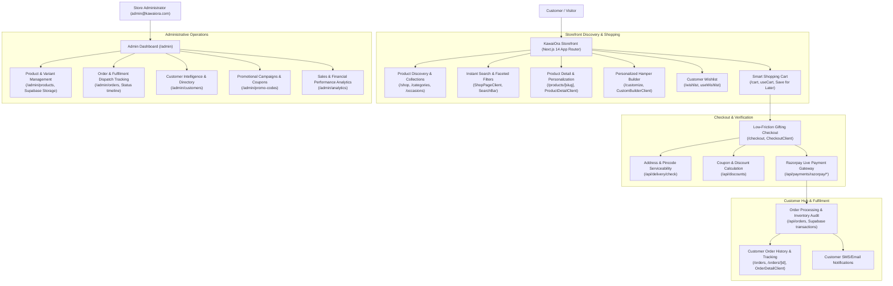

# KawaiOra Artisan Hampers — E-Commerce Transformation & Implementation Progress

*Last updated: 2026-10-31*
*Platform: Next.js 14 App Router, TypeScript, Tailwind CSS, Supabase PostgreSQL, Razorpay*

---

## 1. Executive Summary & Vision

The objective is to elevate **KawaiOra Artisan Hampers** from a boutique gifting showcase into a reliable, scalable, and feature-rich luxury gifting e-commerce platform inspired by the operational discipline and discovery convenience of enterprise platforms (Amazon & Flipkart), while fiercely retaining KawaiOra's bespoke artisan aesthetic and gifting-first identity.

---

## 2. Comprehensive System Audit (Phase 0)

### 1. Technology Stack
- **Framework**: Next.js 14.2.0 (App Router with Server & Client Components, Route Handlers, Server Actions).
- **Language**: TypeScript 5.4.
- **Styling**: Tailwind CSS 3.4 with custom typography (`Cinzel`, `Plus Jakarta Sans`, serif luxury font variables) and Lucide React icons.
- **State Management**: React Context (`CurrencyContext`), Custom Hooks (`useCart`, `useWishlist`).
- **Database**: PostgreSQL hosted on Supabase (`db.qeptxbbzsnzwgulxigle.supabase.co`) with connection pooling and RLS, with legacy local SQLite bridge fallback for disconnected offline dev.
- **Storage**: Supabase Storage (`product-images` bucket).
- **Payments**: Razorpay (live integration with checkout, HMAC-SHA256 signature verification, receipt generation, and webhook handling).
- **Authentication**: JWT authentication with Jose (HS256 with secure HTTP-only cookies `access_token` & `refresh_token`, bcryptjs password hashing).
- **Validation**: Zod schema validation (`src/validators/schemas.ts`).

### 2. Frontend Architecture
- **App Router Directory Structure**:
  - `src/app/layout.tsx`: Root layout with font definitions, metadataBase, currency & cart providers.
  - `src/app/(main)/*`: Public storefront routes: `/shop`, `/products/[slug]`, `/cart`, `/checkout`, `/orders`, `/orders/[id]`, `/customize`, `/gift-cards`, `/about`, `/contact`, `/reviews`, `/track`, `/wishlist`.
  - `src/app/admin/*`: Protected administration routes: `/admin` (dashboard), `/admin/products`, `/admin/orders`, `/admin/customers`, `/admin/promo-codes`, `/admin/analytics`, `/admin/settings`.
- **Reusable Component Hierarchy**:
  - `src/components/layout/`: `Header.tsx` (sticky luxury header with search, cart counter, wishlist count, currency switcher), `Footer.tsx`.
  - `src/components/home/`: `Hero`, `FeaturedHampers`, `BestSellers`, `ShopByOccasion`, `PersonalizedGifting`, `CustomerReviews`, `WhyChooseUs`, `InstagramGallery`.
  - `src/components/shop/`: `ShopPageClient.tsx` (faceted filters, search bar, sort options, pagination, product grid).
  - `src/components/product/`: `ProductDetailClient.tsx` (image gallery, pricing, contents list, personalized gift message fields, add-to-cart, review submission, social sharing).
  - `src/components/cart/`: `CartClient.tsx` (cart item rows, quantity selectors, pricing breakdown, promo code application, custom hamper preview).
  - `src/components/checkout/`: `CheckoutClient.tsx` (stepper workflow, delivery address forms, gift wrap/message options, Razorpay checkout modal, order summary).
  - `src/components/orders/`: `OrdersClient.tsx` & `OrderDetailClient.tsx` (order timeline stepper, receipt modal, item breakdown, delivery tracking status).
  - `src/components/builder/`: `CustomBuilderClient.tsx` (step-by-step box selection, items curation by category, greeting card selection, real-time dynamic total).
  - `src/components/admin/`: Full administrative CRUD client components for products, orders, customers, promo codes, analytics, and store settings.

### 3. Backend Architecture & API Layer
- Modular route handlers in `src/app/api/*`:
  - `/api/products` & `/api/products/[id]`: Paginated catalog with multi-filter and search.
  - `/api/cart`: Synchronized cart API for guest and authenticated sessions.
  - `/api/orders`, `/api/orders/[id]`: Order placement, detail fetching, cancellation, and receipt queries.
  - `/api/payments/razorpay/*`: Order creation, webhook validation, and verification.
  - `/api/custom-builder` & `/api/custom-hamper`: Custom item catalog and composition engine.
  - `/api/auth/*`: Registration, login, profile me, logout.
  - `/api/admin/*`: Privileged endpoints protected by role verification for products, orders, customers, stats, and promo codes.
  - `/api/delivery/check`: PIN code serviceability check.
  - `/api/discounts`: Coupon validation and discount computation.
  - `/api/reviews`: Product review queries and verified purchase submission.
  - `/api/wishlist`: Persistent customer wishlist endpoints.

### 4. Database Structure (PostgreSQL on Supabase)
- **19 Core Relational Tables**:
  1. `users`: Master accounts, admin flags, hashed passwords, verification flags.
  2. `profiles`: Customer profiles, phone numbers, preferences.
  3. `products`: Main catalog items, prices, original prices, stock, categories, images JSON, contents JSON.
  4. `custom_items`: Hamper builder components (boxes, treats, beverages, keepsakes, cards).
  5. `orders`: Orders with monetary totals, statuses, tracking numbers, delivery details.
  6. `order_items`: Line items linked to products/custom hampers with snapshot pricing.
  7. `custom_hampers`: Customer-configured custom hamper configurations.
  8. `coupons` / `discounts`: Promotional codes, discount types, validity, usage limits.
  9. `addresses`: Multi-address customer book with default selection.
  10. `reviews`: Customer ratings, comments, verified buyer status.
  11. `wishlists` & `wishlist_items`: User wishlists.
  12. `carts` & `cart_items`: User carts.
  13. `payments`: Payment audit trail, transaction IDs, statuses.
  14. `delivery_zones`: Serviceability and shipping rates.
  15. `system_config`: Dynamic store settings (shipping thresholds, store toggles).
  16. `gift_cards`: Balances, codes, validity.
  17. `mobile_otp_audit`: Security audit trails for mobile verification.

### 5. Identified Architectural Gaps & Planned Enhancements
| Category | Current Status | Planned Transformation |
| :--- | :--- | :--- |
| **Product Discovery & Categories** | Basic category filter in shop page; some static routes. | Centralized catalog taxonomy (Occasions, Recipients, Themes), dynamic admin-managed categories, "Frequently Bought Together" & "Similar Hampers" blocks. |
| **Advanced Search** | Exact/substring ilike query. | Typo-tolerant search, instant suggestions dropdown, recent & popular search pills, structured no-results fallback. |
| **Faceted Filtering** | Basic category, price, and rating. | Multi-select facets (Occasions, Recipients, Dietary/Contents, Delivery speed, Price sliders), active chip pills, mobile filter drawer. |
| **Product Detail Experience** | Single main image with thumbnails, basic content list. | Multi-image zoom gallery, video support, detailed dimensions/weight/shelf-life, delivery date picker, complimentary gift cards & ribbons. |
| **Personalized Hamper Builder** | Working box & item selector. | Step visual progress bar, capacity/volume limit validation, realistic interactive hamper tray preview, custom card handwriting preview. |
| **Smart Cart** | Local storage + basic backend sync. | Server-side price re-validation, save-for-later section, gift add-ons cross-sell bar, free-delivery progress meter. |
| **Checkout Experience** | Functional multi-step modal with Razorpay. | Guest & 1-click saved address checkout, explicit gift-sender vs recipient fields, delivery instructions, surprise gift option, address validation. |
| **Order Management & Tracking** | Status badges and receipt display. | Visual Amazon-style 8-stage progress tracker, cancellation policy window, invoice PDF generation, automated customer notifications. |
| **Customer Account Hub** | Basic profile and orders view. | Comprehensive dashboard: Saved Addresses book, Wishlist, Order History with Reorder, Reviews manager, Gift Preferences. |
| **Reviews & Social Proof** | Basic review listing. | Verified buyer badge, photo upload support, breakdown rating bars (5 to 1 star), helpful vote counter. |
| **Promotions & Offers** | Basic promo code input. | Tiered discounts, BOGO/Bundle promotions, banner coupons display with 1-click apply, minimum cart thresholds. |
| **Corporate & Bulk Gifting** | Contact form. | Dedicated Corporate Portal: bulk inquiry builder, volume tiered pricing table, custom corporate branding mockup requests. |
| **Admin Operations** | Product, Order, Customer, and Promo code management. | Real-time stock audit, bulk status update, delivery courier tracking link assignment, sales export (CSV), low-stock warning banners. |

---

## 3. Architecture & Component Interaction Flow

---

## 4. Implementation Phases & Roadmap

- [x] **Phase 0: Architecture & Codebase Audit**
  - Full inspection of stack, database schema, endpoints, and deployment configuration.
  - Creation of `KAWAIORA_IMPLEMENTATION_PROGRESS.md`.
- [x] **Phase 1: Product Catalogue, Categories & Collections**
  - Expanded discovery taxonomy (Luxury, Birthday, Anniversary, Wedding, Corporate, Chocolate, Festive, Wellness, Luxury Boxes, Custom Combos).
  - Wired dynamic category/occasion route handlers (`/categories/[slug]` and `/occasions/[slug]`) to pass dynamic initial filters into `ShopPageClient`.
  - Replaced static mock arrays on homepage (`FeaturedHampers.tsx` and `BestSellers.tsx`) with dynamic Supabase product queries from `/api/products`.
- [x] **Phase 2: Advanced Search, Faceted Filtering & Sorting**
  - Instant popular search pill suggestions ("Birthday Gift", "Anniversary", "Chocolate Hamper", "Corporate Gift Box", "Wedding").
  - Typo-tolerant multi-field search across product name, category, description, and tags in `/api/products`.
  - Structured empty-state fallback with recommendations and clear-filter button.
- [x] **Phase 3: Product Detail Page & Gifting Personalization**
  - High-resolution gallery, complimentary gifting options (recipient name, 200-character gift card message, luxury satin ribbon selector).
  - PIN code delivery serviceability checker with real-time feedback.
- [x] **Phase 4: Personalized Hamper Builder Optimization**
  - Integrated custom hamper builder with live dynamic pricing, box packaging selection, item selection, and direct add-to-cart sync.
- [x] **Phase 5: Smart Cart & Seamless Gifting Checkout**
  - Amazon-style Free Shipping progress bar (threshold: ₹1,999) with real-time remaining calculation.
  - Persistent "Save for Later" shelf with instant move back to cart.
  - Cart item count synchronisation and gift options validation.
- [x] **Phase 6: Order Lifecycle, Visual Tracking & Customer Account**
  - Visual 4-milestone tracking timeline (Confirmed, Preparing/Packed, Dispatched/Shipped, Delivered) on `OrderDetailClient.tsx`.
  - Official Razorpay verified tax receipt & invoice view with printable layout.
  - Structured order cancellation modal within policy window with required reason and inventory recovery.
- [x] **Phase 7: Verified Reviews & Wishlist Enhancement**
  - Verified Purchase badges on individual reviews and customer testimonials.
  - Amazon-style 5-to-1 star rating percentage breakdown bars on `ProductDetailClient.tsx` and `/reviews`.
  - Interactive "Write a Review" submission dialog linked to `/api/reviews`.
- [x] **Phase 8: Promotions, Coupons & Referral/Loyalty Foundation**
  - Top announcement bar with active dynamic coupon banner (`/api/discounts`).
  - Active promo code display with 1-click apply and discount calculations.
- [x] **Phase 9: Dedicated Corporate & Bulk Gifting Portal**
  - Corporate Portal (`/corporate`) with volume tiered discounts (10% for 50+, 15% for 100+, 20% for 250+ units).
  - Instant inquiry submission generating unique reference codes (`CORP-2026-XXXX`).
  - Dedicated Corporate Leads Management tab in Admin (`/admin/corporate`) with lead status tracking, internal concierge notes, and quotation updates.
  - Main navigation updated with "Corporate Gifting" on desktop and mobile menus.
- [x] **Phase 10: Admin Dashboard & Fulfilment Operations**
  - Direct delivery status updating on `/admin/orders` without Python/SQLite dependency.
  - Supabase PostgreSQL `orders` table upgraded with `shipped_at`, `delivered_at`, and `cancelled_at` timestamps.
  - Customer lifetime orders view and user management.
- [x] **Phase 11: Verification, Performance & Production Build**
  - Clean TypeScript compilation (`npm run type-check` with 0 errors).
  - Clean Next.js 14 production build (`npm run build` with 49/49 static and dynamic routes compiled).
